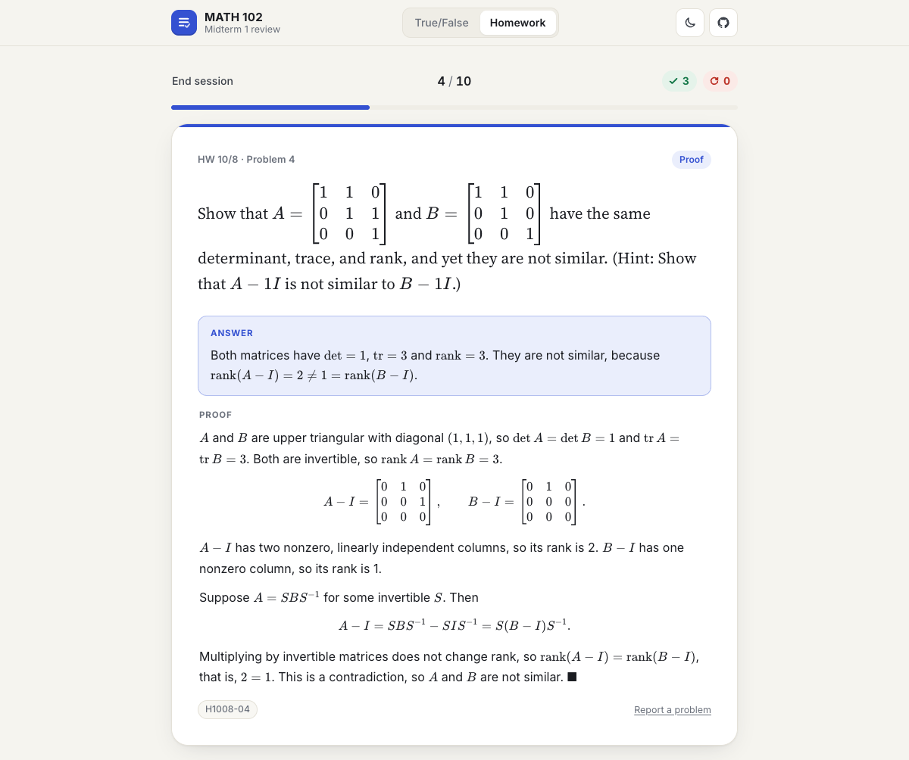

# MATH 102 · Midterm 1 review

Two study tools for MATH 102 Midterm 1, on one site:

- **True or False.** 237 linear algebra statements about rank, similarity, block determinants, trace and more. Answer true or false, and every answer comes with the reason it holds or a counterexample.
- **Homework, worked.** Every Midterm 1 homework problem with its final answer and a full-credit solution. Work it out, reveal the solution, and mark whether you had it.

### ▶ [Play True or False](https://kai124138.github.io/Math102-T-F-game/) · [Open Homework, worked](https://kai124138.github.io/Math102-T-F-game/hw/)

They run in any browser, on a phone or a laptop. Nothing to install, no account needed. A switch at the top of each page jumps to the other one.


## True or False

The 237 statements are split into 11 sections:

| § | Section | Statements |
|---|---|---|
| 1 | Full rank & invertibility | 28 |
| 2 | Subspaces, spans, dimension | 15 |
| 3 | Comparing matrices via their spaces | 20 |
| 4 | Rank (incl. full-rank factorization, powers) | 41 |
| 5 | Products piece by piece | 13 |
| 6 | Commuting & polynomials | 23 |
| 7 | Similarity | 26 |
| 8 | Blocks & determinants (Schur complements, block LDU) | 32 |
| 9 | Trace | 14 |
| 10 | Real vs. complex (Theorem 9.6.3) | 15 |
| 11 | Proof moves | 10 |

127 statements are true and 110 are false, so guessing "true" every time gets you about 54%. The false ones aren't random. Each is a trap you could fall into in a proof:

- **A one-way implication run backwards.** Similar matrices share trace, determinant and rank, but sharing them doesn't make two matrices similar.
- **A dropped hypothesis.** "Square", "distinct eigenvalues", "invertible corner", "over ℝ".
- **A row/column mix-up.** `A = BX` vs. `A = XB`, left vs. right inverse, full row vs. full column rank.
- **A formula that looks right but isn't.** For example, $\det\begin{bmatrix}A&B\\C&D\end{bmatrix} = \det A\det D - \det B\det C$.

Every false statement comes with a concrete counterexample, and the matrix counterexamples were checked numerically.

You can pick sections and a round length, put the statements you missed last time first (**Weak spots first**), replay only your misses at the end of a round, and browse or search every statement. A notation sheet explains the symbols.

| Key | Action |
|---|---|
| `T` or `←` | Answer true |
| `F` or `→` | Answer false |
| `Enter` or `Space` | Next question |
| `Esc` | End the round and see results |
| `R` / `N` | On the results screen: replay missed / new round |

Each answer shows chips such as **§7**, **H1008-04**, **L4S-33**, **P.3.26** or **Thm 9.6.3**. They point to the section, homework problem, course notes, or textbook result each fact comes from. Textbook numbers follow Garcia & Horn, *A Second Course in Linear Algebra*.

## Homework, worked



| Set | Topics | Problems |
|---|---|---|
| HW 9/24 | Block multiplication, block inverses, trace | 19 |
| HW 9/29 | Matrix products, polynomials, elementary matrices, similarity | 33 |
| HW 10/1 | Block determinants, Schur complements | 8 |
| HW 10/6 | Full-rank factorization, column space, rank | 29 |
| HW 10/8 | Rank, similarity invariants, independence | 10 |
| HW 10/13 | Real similarity of real matrices (Thm 9.6.3) | 8 |
| HW 10/13 · Math 18 review | Diagonalization (Lay §5.3), not on Midterm 1, off by default | 36 |

Problems the professor marked ✱ (not assigned) are left out. Multi-part problems show their shared setup on every part, and each step of the P.3.26 guided proof shows the statement it refers to. Two problems are tagged as possible midterm proofs (Lemma 3.2.17 and Theorem 2.3.7).

Work each problem out first. Then reveal the answer and solution, and mark **Got it** or **Review again**. You can filter by type (computations, proofs, explain & verify, true/false) and order problems as assigned, shuffled, or weak spots first. Shuffling keeps the parts of a problem together and in order. At the end of a session you can replay just the problems you flagged, and **Browse all problems** has search and a "Show solutions" switch.

| Key | Action |
|---|---|
| `Space` or `Enter` | Show the solution |
| `G` or `←` | Got it |
| `R` or `→` | Review again |
| `Esc` | End the session and see results |

The solutions are a study aid, not official course material. Try each problem before you look, and check anything surprising against your notes.

## Your progress

Both pages save your progress **only in your own browser** (localStorage, not cookies). Nothing is sent anywhere. Progress is per device and per browser, and **Reset progress** on each home screen clears it.

## Mistakes

If something looks wrong, [open an issue](https://github.com/kai124138/Math102-T-F-game/issues). Every question has a **Report a problem** link that fills in which one you mean.

## Run it locally

It's a static site (HTML, CSS and plain JavaScript):

```sh
git clone https://github.com/kai124138/Math102-T-F-game.git
cd Math102-T-F-game
python3 -m http.server 8000     # then open http://localhost:8000 (homework page: /hw/)
```

You need an internet connection, because KaTeX (math), marked (Markdown, on the homework page) and the fonts load from a CDN.

## Editing content

**True or False statements** live in [`questions.js`](questions.js), one line each:

```js
//  section  answer  statement                                  explanation                                   tag (optional)
    [7,      F,      L`$\tr A=\tr B \implies A\sim B$.`,        L`$\sm{1&1\\0&1}$ and $I$ share a trace…`,    "H1008-04"],
```

Math goes inside `$…$` and is rendered by [KaTeX](https://katex.org). `L` is `String.raw`, so backslashes need no escaping. `**bold**` works in the plain-text parts. The top of the file defines these shortcuts: `\rank`, `\nul`, `\col`, `\row`, `\tr`, `\diag`, `\RREF`, `\spn`, `\F`, `\R`, `\C`, `\T` (transpose, as in `A^\T`), `\conj{A}`, `\sm{a&b\\c&d}` (small inline matrix) and `\mat{…}` (full-size matrix).

**Homework problems** in [`hw/problems.js`](hw/problems.js) are generated, so don't edit that file by hand. It's built from the course question bank and answer key (Markdown files kept outside this repo) by [`tools/build_problems.py`](tools/build_problems.py), which stops with an error if any problem is missing its solution.

Saved progress is keyed to each statement's text (True or False) or problem ID (Homework). Editing a statement resets the saved progress for that one statement.

## Files

```
index.html, app.js, questions.js   True or False page, game logic, and the 237 statements
style.css                          shared design (light and dark themes)
hw/index.html, hw/app.js           Homework page and its session logic
hw/render.js                       Markdown + LaTeX rendering
hw/hw.css                          homework-specific styles
hw/problems.js                     generated homework data (143 problems)
tools/build_problems.py            builds hw/problems.js
assets/                            preview images
```
