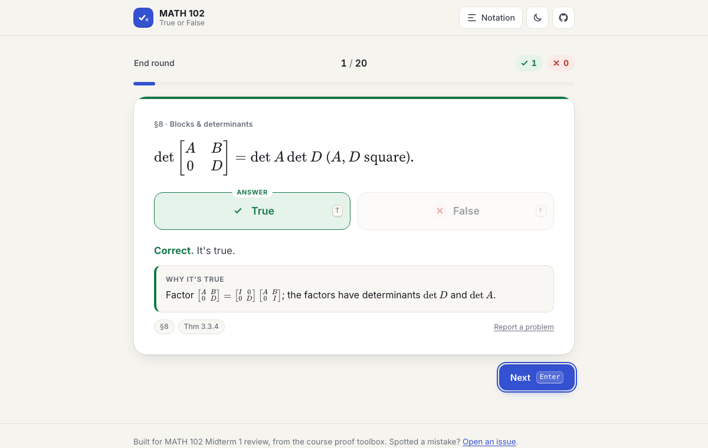

# MATH 102 · True or False

A true/false drill for the MATH 102 Midterm 1 proof toolbox. You get 237 linear algebra statements about rank, similarity, block determinants, trace and more. Answer true or false, and every answer comes with the reason it holds or a counterexample.

### ▶ [Play it here: kai124138.github.io/Math102-T-F-game](https://kai124138.github.io/Math102-T-F-game/)

It runs in any browser, on a phone or a laptop. Nothing to install, no account needed.



## What's in it

The 237 statements are split into the 11 sections of the proof toolbox:

| § | Section | Statements |
|---|---|---|
| 1 | Full rank & invertibility | 28 |
| 2 | Subspaces, spans, dimension | 15 |
| 3 | Comparing matrices via their spaces | 20 |
| 4 | Rank (incl. full-rank factorization, powers) | 41 |
| 5 | Products piece by piece | 13 |
| 6 | Commuting & polynomials | 23 |
| 7 | Similarity | 26 |
| 8 | Blocks & determinants (Schur complements, block LDU) | 32 |
| 9 | Trace | 14 |
| 10 | Real vs. complex (Theorem 9.6.3) | 15 |
| 11 | Proof moves | 10 |

127 statements are true and 110 are false, so guessing "true" every time gets you about 54%. The false ones aren't random. Each is a trap you could fall into in a proof:

- **A one-way implication run backwards.** Similar matrices share trace, determinant and rank, but sharing them doesn't make two matrices similar.
- **A dropped hypothesis.** "Square", "distinct eigenvalues", "invertible corner", "over ℝ".
- **A row/column mix-up.** `A = BX` vs. `A = XB`, left vs. right inverse, full row vs. full column rank.
- **A formula that looks right but isn't.** For example, $\det\begin{bmatrix}A&B\\C&D\end{bmatrix} = \det A\det D - \det B\det C$.

Every false statement comes with a concrete counterexample, and the matrix counterexamples were checked numerically.

## Features

- **Pick your sections** and a round length (10, 20, 40 or all).
- **Weak spots first** puts the statements you missed last time at the front of the round.
- **Replay missed** re-runs only the ones you got wrong at the end of a round.
- **Browse all statements**: search the full list, filter by section, and reveal answers one at a time or all at once.
- **Notation sheet** explains every symbol the game uses.
- Light and dark mode, and it works on phones.
- Your progress is saved **only in your own browser** (localStorage). Nothing is sent anywhere.

### Keyboard

| Key | Action |
|---|---|
| `T` or `←` | Answer true |
| `F` or `→` | Answer false |
| `Enter` or `Space` | Next question |
| `Esc` | End the round and see results |
| `R` / `N` | On the results screen: replay missed / new round |

## Reference tags

Each answer shows chips such as **§7**, **H1008-04**, **L4S-33**, **P.3.26** or **Thm 9.6.3**. They point to the toolbox section, course homework, notes, or textbook result each fact comes from. Textbook numbers follow Garcia & Horn, *A Second Course in Linear Algebra*.

This is an unofficial study tool, not course material. If something looks wrong, check it against your notes and [open an issue](https://github.com/kai124138/Math102-T-F-game/issues). Every question has a **Report a problem** link that fills in which statement you mean.

## Run it locally

It's a static site (HTML, CSS and plain JavaScript, no build step):

```sh
git clone https://github.com/kai124138/Math102-T-F-game.git
cd Math102-T-F-game
python3 -m http.server 8000     # then open http://localhost:8000
```

Opening `index.html` directly also works. You need an internet connection either way, because KaTeX (the math renderer) and the fonts load from a CDN.

## Adding or fixing a statement

All statements live in [`questions.js`](questions.js). Each one is a single line:

```js
//  section  answer  statement                                  explanation                                   tag (optional)
    [7,      F,      L`$\tr A=\tr B \implies A\sim B$.`,        L`$\sm{1&1\\0&1}$ and $I$ share a trace…`,    "H1008-04"],
```

- Math goes inside `$…$` and is rendered by [KaTeX](https://katex.org). `L` is `String.raw`, so backslashes need no escaping.
- `**bold**` works in the plain-text parts.
- Shortcuts defined at the top of the file: `\rank`, `\nul`, `\col`, `\row`, `\tr`, `\diag`, `\RREF`, `\spn`, `\F`, `\R`, `\C`, `\T` (transpose, as in `A^\T`), `\conj{A}`, `\sm{a&b\\c&d}` (small inline matrix) and `\mat{…}` (full-size matrix).

Saved progress is keyed to each statement's text, so editing a statement resets the saved progress for that one statement.

## Files

```
index.html     page structure
style.css      design (light and dark themes)
app.js         game logic, rendering, saved progress
questions.js   the 237 statements, section names and KaTeX shortcuts
assets/        preview image
```
